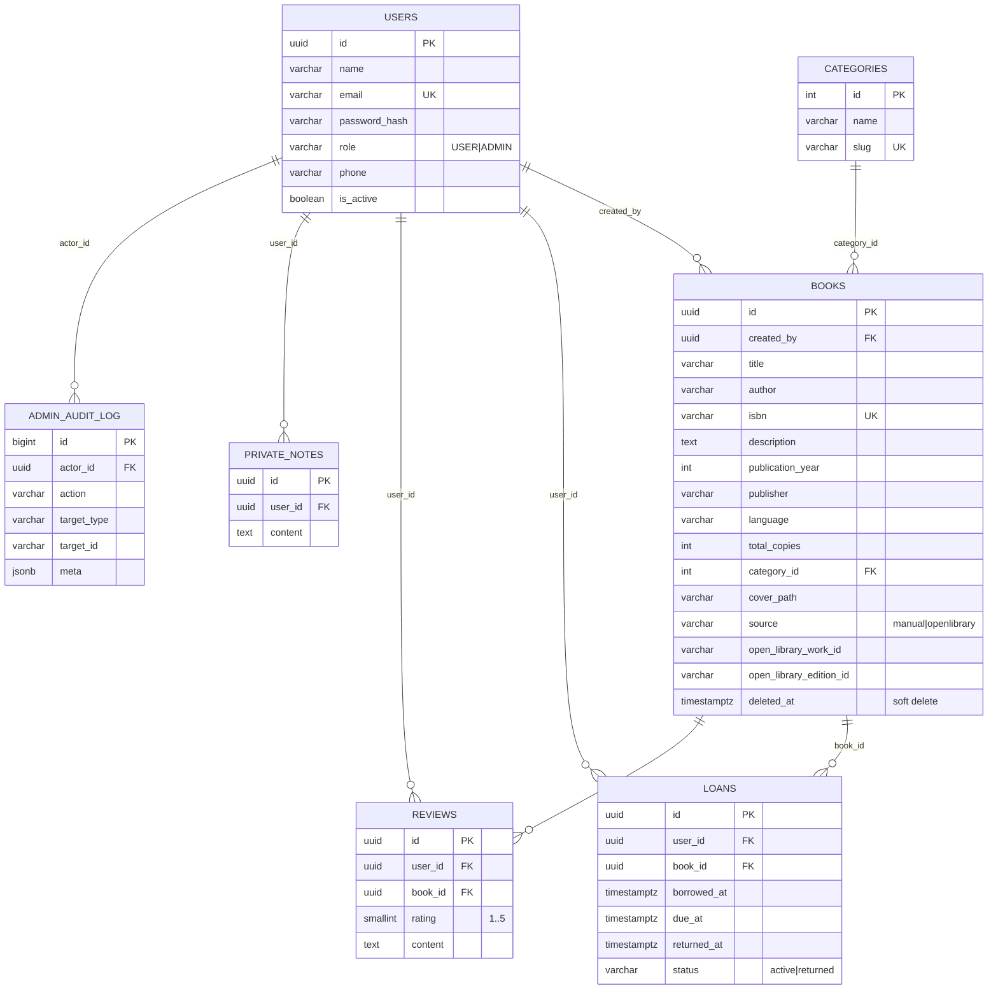

# ShelfFlow — diagrama entitate-relație

## Reguli de integritate

- `users.email` unic case-insensitive (`unique index on lower(email)`).
- `books.isbn` unic doar între cărțile neșterse (index parțial `WHERE deleted_at IS NULL`).
- `books.open_library_edition_id` unic la fel — blochează importurile duplicate.
- `loans` are `CHECK` care leagă `status` de `returned_at`; un singur împrumut activ per utilizator și carte.
- `reviews` are `UNIQUE (user_id, book_id)`.
- Ștergerea unei cărți este **soft delete** (`deleted_at`); ștergerea fizică este blocată cât timp există împrumuturi active.
- Disponibilitatea nu este stocată: se calculează ca `total_copies - COUNT(loans active)`, deci nu poate divergea.
